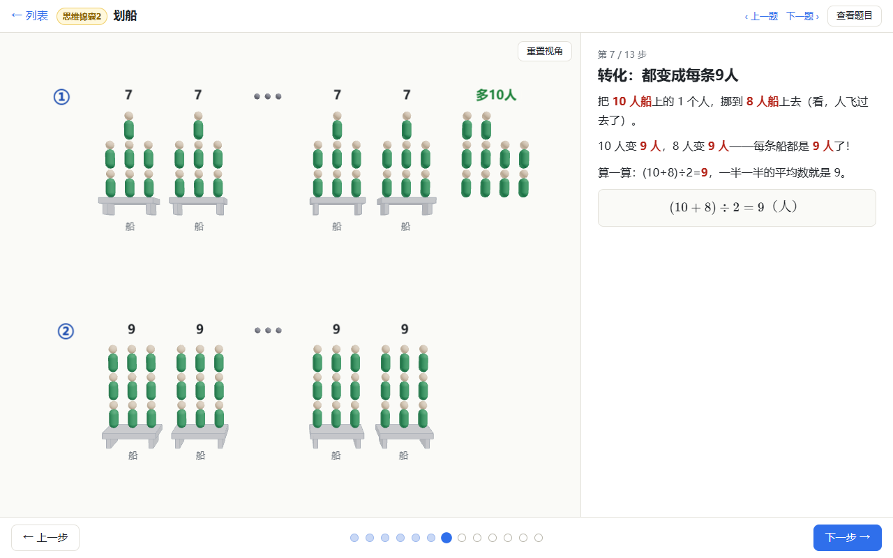
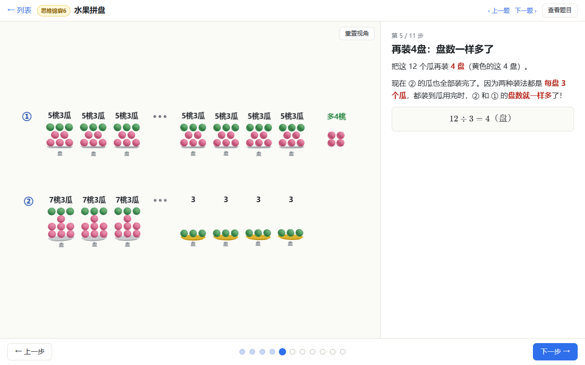
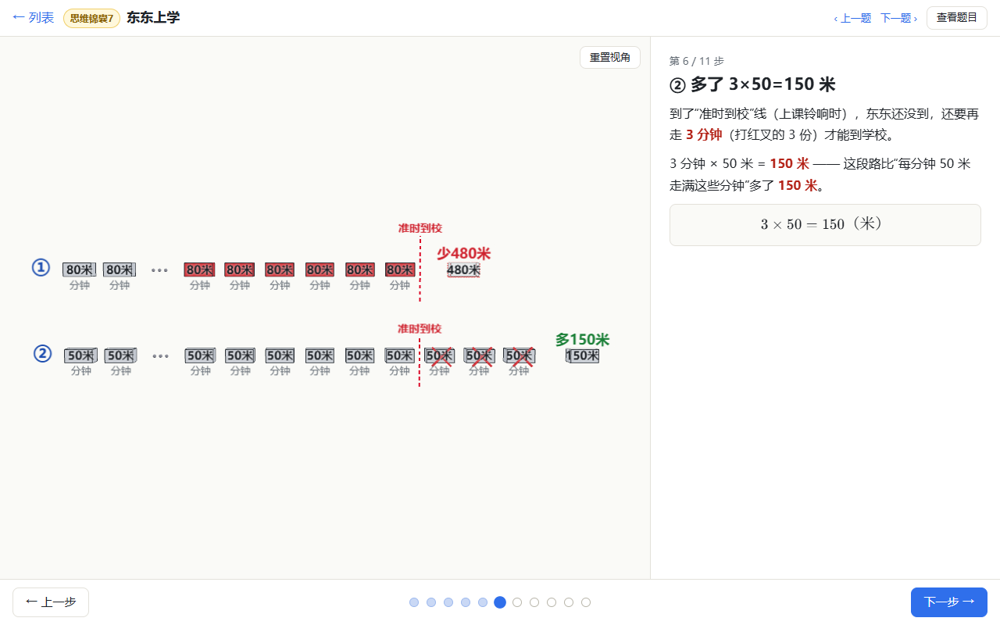
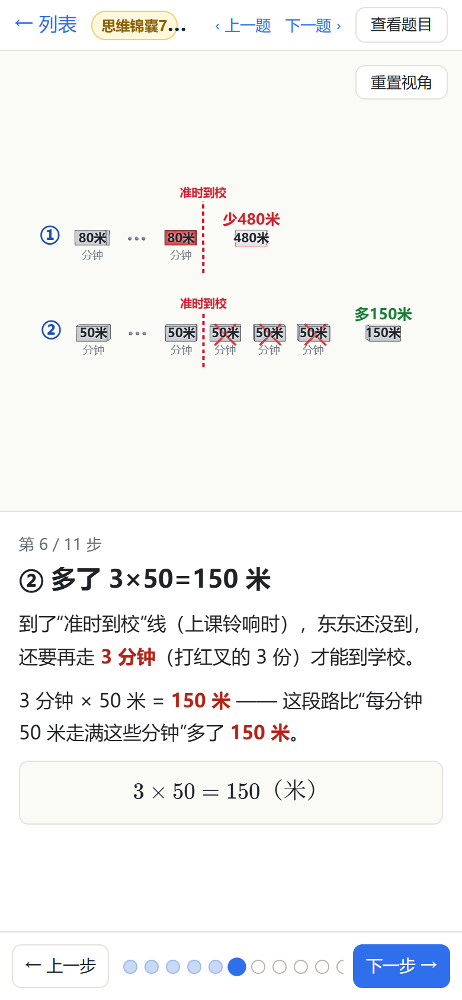

# 小学奥数 3D 分步讲解

把一道奥数题拆成若干步骤：每一步 = **3D 画面的变化 + 图文讲解卡片**，可以逐步播放、任意跳步、随时后退。纯前端静态站点，题目是 `content/problems/` 里的 JSON 文件，无后端、无 AI 生成。

**在线体验：<https://452242533.xyz>**

GitHub 仓库：<https://github.com/robinzenzhu-web/olympiad-3d>

- 技术栈：Vite + React 19 + TypeScript(strict) + three / @react-three/fiber / drei + zustand + zod + KaTeX + vitest
- 核心思路：`computeStates(problem)` 把每一步折叠成一个**状态快照**，3D 舞台只负责把当前快照平滑过渡出来，所以跳步、后退都是确定的。
- 技术规格见 [docs/DESIGN.md](docs/DESIGN.md)；**出题人请看 [docs/AUTHORING.md](docs/AUTHORING.md)**。

## 截图

划船（思维锦囊2）：10 人船各挪 1 人到 8 人船，每条船都变成 9 人——用平均数统一每份量。



水果拼盘（思维锦囊6）：多出的 12 个瓜再装 4 盘，把盘数统一起来。



东东上学（思维锦囊7）：把路的长度分给每一分钟，画出「准时到校」线。



手机竖屏（390×844）效果：



## 题目内容

当前共 14 道题，打开首页即可看到，按系列分组。

**三秋 S06 · 盈亏进阶**（差量分析，12 道，同一套方法贯穿始终：份数 = 总差 ÷ 每份差）

| 小节 | 题目 | 关键转化 |
|---|---|---|
| 承前启后 | 沙和尚分野果 | 两人分不到 → 少 10 颗（一盈一亏） |
| 思维锦囊1 | 玫瑰花瓶 | 「还能装 3 瓶」→ 多 18 朵 |
| 思维锦囊2 | 划船 | 一半 8 人一半 10 人 → 每条 9 人（统一每份量） |
| 思维锦囊3 | 超市买东西 | 买的东西 → 花的钱数（表面 / 本质） |
| 思维锦囊4 | 午饭坐桌子 | 3 张坏桌：把「多 6 人」改成「少 18 人」（统一桌数） |
| 思维锦囊5 | 玻璃杯和保温杯 | 两种方法：统一杯数 / 统一杯子类型 |
| 小试牛刀1 | 纯牛奶和酸奶 | 同上思路独立练一遍 |
| 思维锦囊6 | 水果拼盘 | 再装 4 盘（统一盘数） |
| 小试牛刀2 | 红白球 | 再装 50 份（统一份数） |
| 思维锦囊7 | 东东上学 | 把路的长度分给每一分钟（行程中的盈亏） |
| 思维锦囊8 | A箱B箱硬币 | 把面值分给硬币，统一硬币个数 |
| 学有所得 | 本讲小结 | 三大相同、差量分析、总公式 |

**其他**（2 道）

- 正方体表面涂色（3×3×3）：8 / 12 / 6 / 1 分类计数，末尾用滑块探索 n×n×n
- 数积木与三视图：按层数积木，正视图 / 左视图 / 俯视图

题目来源：学而思素养《盈亏进阶》公开讲义。讲解忠于老师板书的记号与思路，面向三～五年级。

## 功能

- 分步播放、点击步骤圆点跳步、上一步 / 下一步（键盘 ← → 也可以）
- 3D 场景可拖动旋转、滚轮 / 双指缩放，右上角有「重置视角」
- 板凳模型（Bench）：把「① 3 3 … 3 多16颗」这类板书直接摆出来，支持搬动物件、多 / 少、大括号、竖线
- 正方体切块（涂色问题）与积木堆（数积木 + 三视图，正交投影）
- 选择题「想一想」：选完立刻给对错和解析，也可以不作答直接看下一步
- 滑块探索：拖参数实时改变 3D 与公式（如边长 n）
- 手机 / 桌面自适应：窄屏自动换用更短的显示区间，保证文字不挤成一团
- 题目 JSON 写错时精确报错：文件名 / 第几步 / 哪个字段 / 原因，其他题目不受影响，不会白屏

## 运行

需要 Node.js 18+（已在 Node 22 下验证）。

```bash
git clone https://github.com/robinzenzhu-web/olympiad-3d.git
cd olympiad-3d
npm install
npm run dev      # 开发服务器，默认 http://localhost:5173/
npm run build    # 类型检查 + 生产构建，产物在 dist/（可直接放到任意静态服务器）
npm test         # 运行 vitest
```

> 如果你的环境设置了 `NODE_ENV=production`，`npm install` 会跳过 devDependencies，请用 `npm install --include=dev`，并在运行 `npm run dev` / `npm test` 前取消该变量。

路由是 hash 路由：`#/` 题目列表，`#/p/题目id` 讲解页，因此静态托管不需要任何服务端重写规则。

## 部署

网站托管在 **Cloudflare Pages**，绑定域名 <https://452242533.xyz>。项目配置见 [wrangler.toml](wrangler.toml)（构建产物目录 `./dist`）。

```bash
npm run deploy        # 先 npm run build，再 wrangler pages deploy --branch main
npx wrangler login    # 首次部署，或登录过期时先执行这一句
```

- 改完后线上要等部署返回的预览地址 / 域名生效（一般几十秒）。
- **回滚**：Cloudflare 后台 → Workers 和 Pages → 选择项目 → 部署 → 在历史版本上点「回滚」。

## 日常更新流程

```bash
git add -A
git commit -m "改了哪些题 / 修了什么"
git push
npm run deploy
```

前三条把改动存进 GitHub；`npm run deploy` 才会真正更新网站。只改题目 JSON 也需要重新构建部署。

## 目录

```
content/problems/*.json   题目（出题人只改这里）
public/                   可选：步骤配图（步骤的 image 字段相对此目录，需要时新建）
src/schema/               zod schema + 类型（DSL 定义）
src/engine/               纯函数：cells 属性预计算 / filter / expr 安全表达式 / state 状态快照 / validate 语义校验 / bench 板凳模型（盈亏问题）/ fit 自动取景
src/stage/                3D 渲染（每个 cell 一个 mesh，逐面着色，useFrame 阻尼插值，CameraControls；Bench3D / Arrow3D 画板凳模型）
src/player/               播放器 UI：步骤卡片、控制条、quiz、explore、KaTeX 公式、playback store
src/pages/                列表页、讲解页、错误展示
src/content.ts            加载 + 校验题目，出错显示 文件名/第几步/字段/原因
src/catalog.ts            题目分组（series / order / section）与同系列上一题、下一题
tests/                    vitest：engine 全部 + 所有题目文件的校验
docs/                     DESIGN.md（技术规格）、AUTHORING.md（出题指南）、briefs/（内容简报）、screenshots/（展示截图）、qa-progress.md（视觉 QA 记录）
wrangler.toml             Cloudflare Pages 项目配置（部署用）
```

## 新增一道题

1. 复制 `content/problems/cube-paint-3.json` 改名（盈亏题复制 `yk-01-yeguo.json`）；
2. 按 [AUTHORING.md](docs/AUTHORING.md) 修改；
3. 保存后刷新页面。写错时列表页顶部会显示具体错误位置，其他题目不受影响；
4. `npm test` 会自动校验 `content/problems/` 下的每一个文件。

## 文档

- [docs/DESIGN.md](docs/DESIGN.md)：技术规格（架构、DSL、渲染层、播放器）
- [docs/AUTHORING.md](docs/AUTHORING.md)：出题指南（不用懂代码）
- [docs/briefs/](docs/briefs/)：内容简报（每讲的题目、答案与老师思路）
